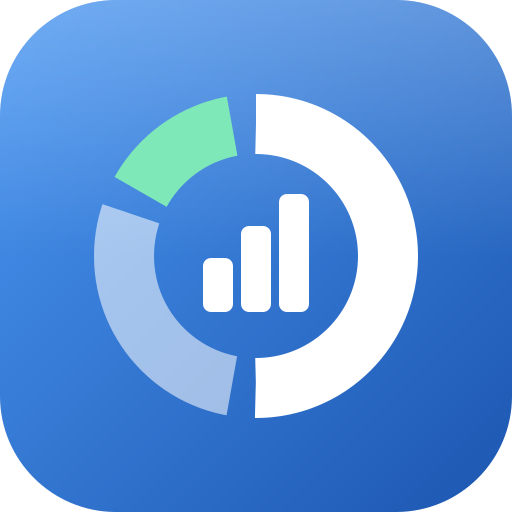
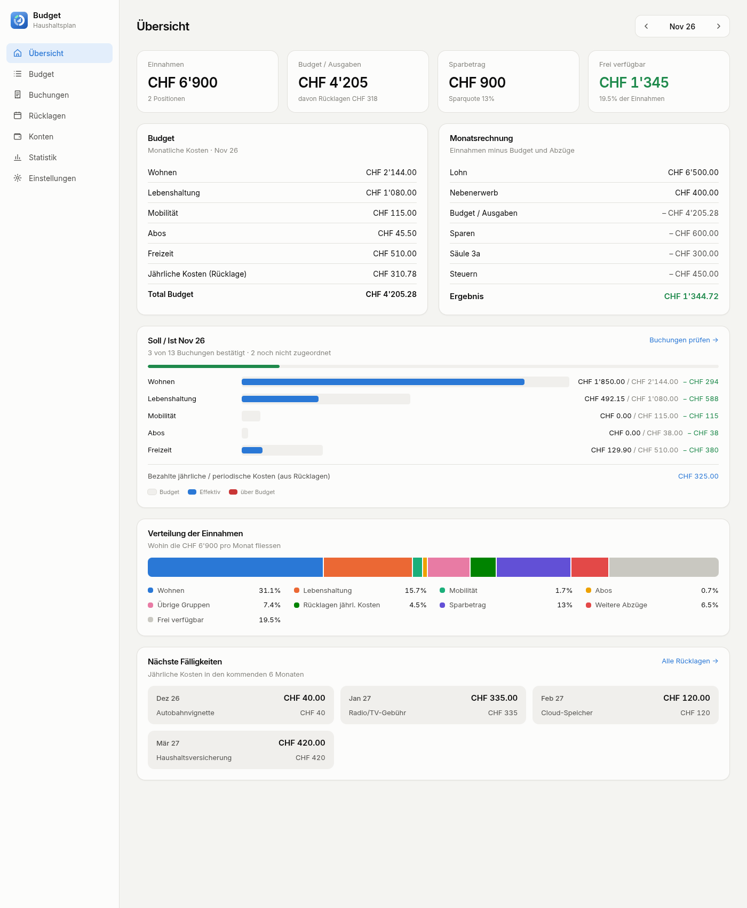
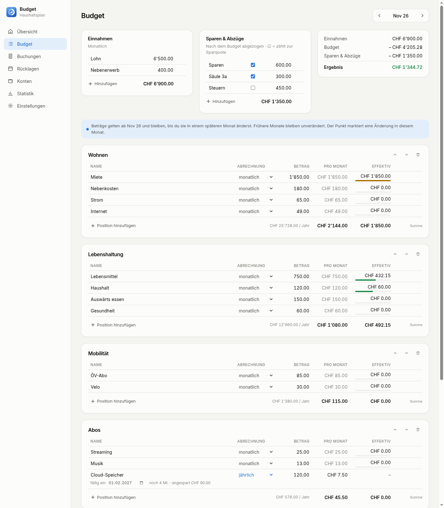
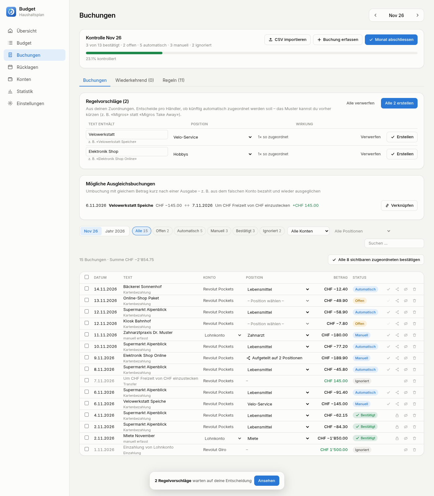
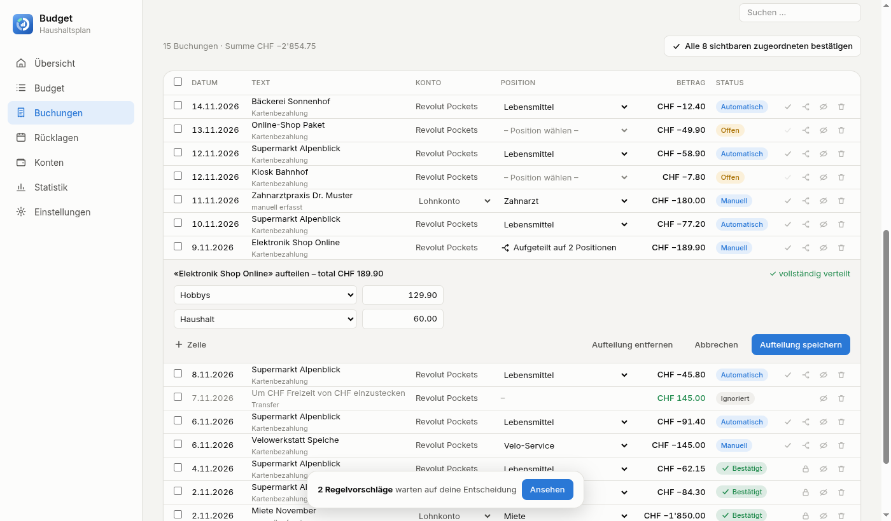
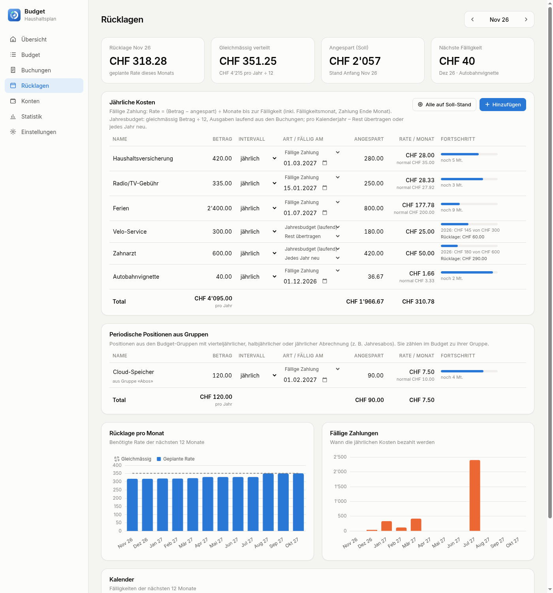
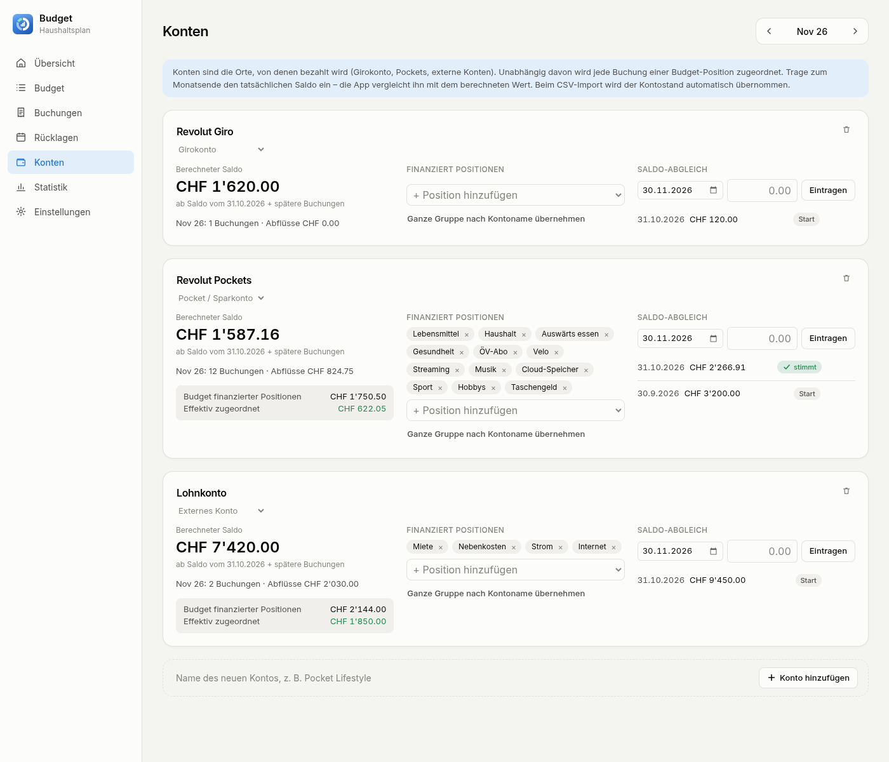
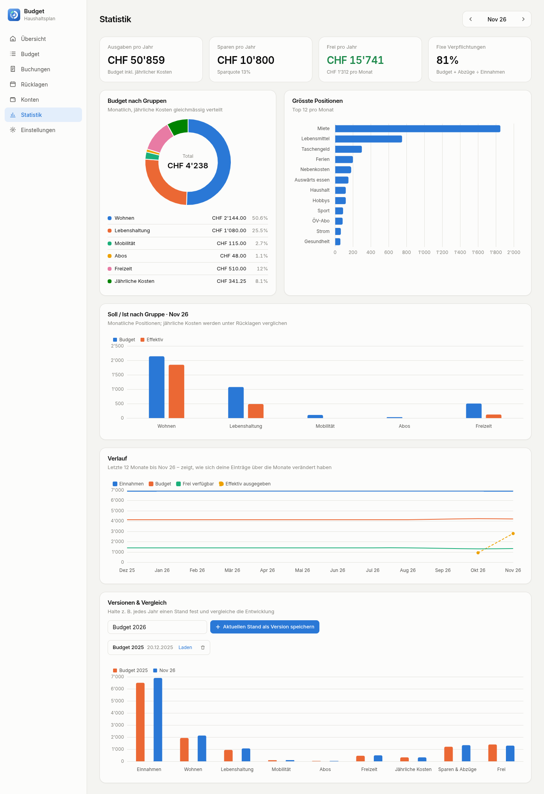
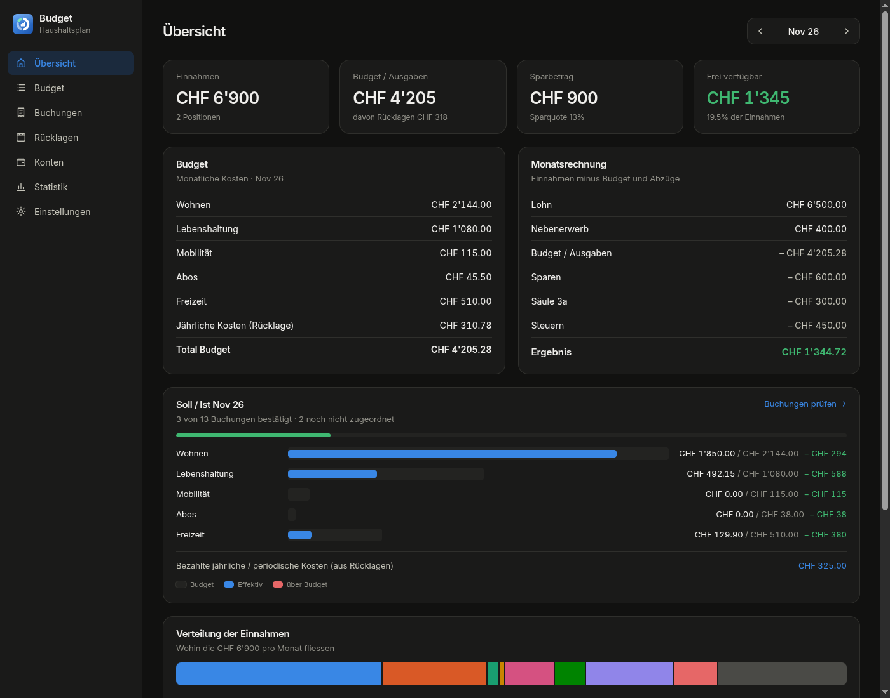

<p align="center"></p>

# budget-planer

Lokaler Budget-Planer für NixOS (Electron aus nixpkgs). Alle Daten bleiben auf dem eigenen Rechner in einer JSON-Datei.

- Budget nach Gruppen, Einnahmen, Sparen & Abzüge – direkt in Tabellen bearbeitbar
- **Monatsabhängige Beträge**: Ein Betrag gilt ab dem Monat, in dem er eingetragen wird, bis er in einem späteren Monat geändert wird. Frühere Monate bleiben unverändert.
- **Rücklagen für jährliche Kosten**, zwei Arten:
  - *Fällige Zahlung*: `Rate = (Betrag − angespart) / Monate bis zur Fälligkeit`, der Fälligkeitsmonat
    zählt mit (Zahlung Ende Monat); danach beginnt der nächste Zyklus im Folgemonat mit `Betrag / Intervall`.
  - *Jahresbudget*: gleichmässig `Betrag / 12`, laufende Ausgaben aus den Buchungen; pro Kalenderjahr,
    Rest wird übertragen oder jedes Jahr neu.

  Auch einzelne Positionen in Gruppen (z. B. ein Jahresabo) können jährlich abgerechnet werden.
- **Buchungen & Soll/Ist**: Kontoauszug (Revolut-CSV) importieren oder Buchungen von Hand erfassen,
  Positionen zuordnen, Regeln aus Vorschlägen erstellen, Buchungen aufteilen, kontrollieren und bestätigen
  (auch gesammelt), Monat abschliessen. Budget, Übersicht, Rücklagen und Statistik zeigen Soll gegenüber Ist.
- **Manuelle Buchungen**: Ausgabe, Gutschrift oder Umbuchung zwischen eigenen Konten (z. B. Spaces/Pockets),
  einmalig oder **wiederkehrend** (monatlich, vierteljährlich, jährlich) – wiederkehrende Buchungen werden
  an jedem Termin automatisch erzeugt.
- **Konten**: Girokonto, Pockets, externe Konten; Saldo-Abgleich mit Korrekturbuchungen.
- Statistiken, Verlauf, Versionen zum Vergleichen, CSV-Export, hell/dunkel

Details zum Konzept: [KONZEPT.md](KONZEPT.md)

## Screenshots

> Alle Screenshots zeigen erfundene Beispieldaten.

### Übersicht
Einnahmen, Budget, Sparquote und frei verfügbarer Betrag auf einen Blick, dazu Soll/Ist pro Gruppe,
die Verteilung der Einnahmen und die nächsten Fälligkeiten.



### Budget
Gruppen und Positionen direkt in der Tabelle bearbeiten. Beträge gelten ab dem gewählten Monat;
pro Position monatliche oder periodische Abrechnung. Die Spalte *Effektiv* zeigt die zugeordneten Ausgaben.



### Buchungen
CSV-Import mit Duplikaterkennung, Kontrolle mit Status und Massenbestätigung, Regelvorschläge aus den
eigenen Zuordnungen und erkannte Ausgleichsbuchungen.



Eine Buchung lässt sich auf mehrere Positionen aufteilen:



### Rücklagen
Fällige Zahlungen mit Monatsrate bis zur Fälligkeit und Jahresbudgets mit laufenden Ausgaben,
Vorschau der Raten, Fälligkeiten und Kalender.



### Konten
Konten mit finanzierten Positionen und Saldo-Abgleich; Differenzen werden mit einer Korrekturbuchung ausgeglichen.



### Statistik
Budget nach Gruppen, grösste Positionen, Soll/Ist, Verlauf über 12 Monate und Vergleich mit gespeicherten Versionen.



### Dunkles Design



## Starten

```sh
nix run github:Memurame/budget-planer
# oder lokal
nix run .
```

## In die NixOS-Konfiguration einbinden

`/etc/nixos/flake.nix`:

```nix
inputs.budget-planer = {
  url = "github:Memurame/budget-planer";
  inputs.nixpkgs.follows = "nixpkgs";
};

# outputs = { ..., budget-planer, ... }:
{ nixpkgs.overlays = [ budget-planer.overlays.default ]; }
```

Danach das Paket `budget-planer` installieren (z. B. in `home.packages`) – es erscheint als **Budget** im App-Menü.
Der frühere Paketname `budget` funktioniert vorerst weiter als Alias.

## Daten

- Datei: `~/Documents/Budget/budget.json` bzw. `~/Dokumente/Budget/budget.json` (in der App unter *Einstellungen* änderbar)
- Buchungen pro Jahr: `buchungen/JJJJ.json` im selben Ordner
- Tägliche Sicherung pro Datei im Unterordner `backups/`
- Beim ersten Start wird eine leere Vorlage angelegt; danach ist die Datei der Master.

## Entwicklung

```sh
nix develop
npm install
npm run dev        # Oberfläche im Browser (Daten in localStorage)
npm run dev:app    # Electron gegen den Dev-Server (parallel zu npm run dev)
```

Nach Änderungen an `package-lock.json` muss `npmDepsHash` in `package.nix` aktualisiert werden
(auf `lib.fakeHash` setzen, `nix build` ausführen, Hash aus der Fehlermeldung übernehmen).

## Lizenz

MIT
